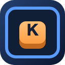

[简体中文](README.md) | English

# browser_keywords_extension

<p align="center">
  
</p>

A keyboard-driven Chrome extension that binds repetitive actions — dragging, clicking, magnifying — to a single key so you can replay them instantly. Configurations are stored per tab, and more shortcuts are planned.

## Features

### Drag & click replay
Record a key → pick the start point → pick the end point. Pressing that key replays the mouse drag with easing; drag duration, hold-after-press and move steps are configurable. You can also set "start = current cursor", so the drag goes from wherever the mouse is to a fixed end point.

### Point click
Record a key → pick a position. Pressing that key clicks that exact coordinate once.

### Area click
Record a key → drag out a region. Pressing that key clicks every point in the region on a grid (5px by default) — handy for popping balloons, clearing lists and other high-frequency clicking. Grid spacing and click interval are configurable.

### Magnifier
Record a key (e.g. Q) → press once to turn it on, press again (or press ESC) to turn it off. A 180×180 lens then follows the cursor and magnifies the page content underneath it in real time, centered on the cursor. The zoom level is configurable in the panel (1.2 – 6, default 2.4).

- Implemented as a DOM mirror plus a `transform` scale: each frame only updates translation/scale, so it tracks the cursor at 60fps with no screenshot permission required.
- The mirror is rebuilt automatically after DOM changes; CSS animations keep playing.
- Known limitation: pixels inside `<canvas>` and `<video>` are not replicated.

### High-compatibility mode
By default, events are simulated inside the page, which works with most components. If dragging does nothing (native `draggable`) or clicks are ignored (file inputs, games), enable "High-compatibility mode" to dispatch real input events via `chrome.debugger`. Note: this mode requires the extension's debugger permission, and the target page cannot have DevTools open at the same time.

## Install

```bash
npm install
npm run build
```

Then open `chrome://extensions` → enable "Developer mode" → "Load unpacked" → select the `dist` folder in this project. Click the extension icon in the toolbar to open the settings panel.

## Usage

1. Open the panel and pick a tab (Drag / Area / Point / Magnifier).
2. Click "＋ New…" and follow the prompts to record a key, pick a coordinate or draw a region.
3. Press that key on any page to run it. From the panel you can rebind, re-pick coordinates, disable or delete it at any time.
4. Turning off "Enable all" pauses every shortcut. The panel can be dragged anywhere and remembers its position per tab.

## Development

```bash
npm run dev        # watch-build the content script
npm run typecheck  # type checking
npm run build      # build to dist/
```

Build output: `dist/manifest.json`, `dist/content.js` (in-page script), `dist/background.js` (service worker).

## Test page

`test-page.html` in the project root is a functional test page: squares can be dragged into the trash bin, bubbles can be popped in bulk with area clicks, and the magnifier can be verified there too.

Do not open it via `file://` (content scripts are not injected into local files). Serve it over a local static server instead:

```bash
python3 -m http.server 8080
# then visit http://localhost:8080/test-page.html
```

## Project structure

```
public/manifest.json   extension manifest
src/background/        service worker: tabId / storage, CDP drag and clicks
src/content/           content script: panel UI, key recording, coordinate picking, execution
src/content/magnifier.ts   magnifier (DOM mirror + transform)
src/content/drag.ts        in-page drag/click simulation
src/types.ts           shared types and default settings
```
